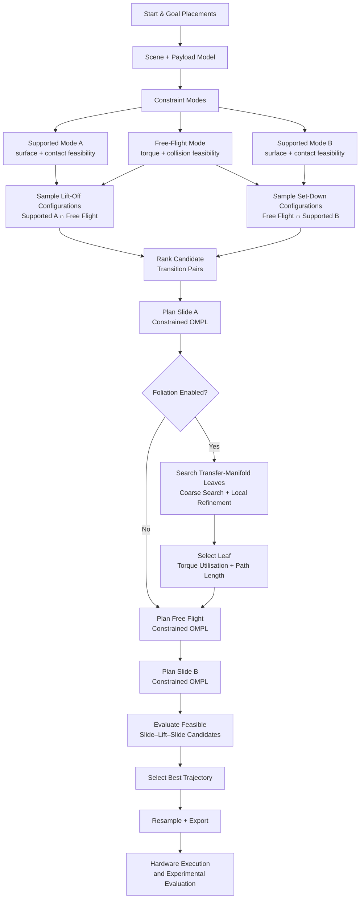

# Multi-Modal Path Planning on Constraint Manifolds for Robotic Manipulation

Master's thesis project on constraint-manifold motion planning for robotic manipulation under payload and torque limitations.

The planner combines supported sliding and free-space transport to generate **slide-lift-slide** trajectories. Environmental support is treated as an additional manipulation mode, allowing the robot to move payloads through configurations that may not be feasible during unsupported carrying.

## 4.1 kg Payload Demonstration

[](hardware_results/4.1kg/overlay_video.mp4)

**Click the animation above to open the full 4.1 kg hardware demonstration video.**

Additional experiment videos:

- [4.1 kg overlay video](hardware_results/4.1kg/overlay_video.mp4)
- [4.1 kg animation](hardware_results/4.1kg/animation_video.mp4)
- [2.1 kg overlay video](hardware_results/2.1kg/overlay_video.mp4)
- [2.1 kg animation](hardware_results/2.1kg/animation_video.mp4)

## Overview

The project investigates multi-modal robotic manipulation in which the robot can transition between:

- supported motion along a surface,
- free-space transport,
- and transitions between these constraint manifolds.

Torque feasibility is evaluated during planning. When unsupported carrying becomes infeasible under the selected torque limits, environmental support can be exploited to continue the transport task.

The repository contains the planner implementation, constraint handling, OMPL-based constrained planning, payload modelling, foliation-based free-carry refinement, experimental scripts, trajectory data and hardware-result visualisations.

## Planning Pipeline

The planner formulates supported motion and free-space transport as distinct constraint modes. Lift-off and set-down configurations are sampled from intersections between these modes, after which constrained motion planning is performed for each segment.



The three motion segments of the resulting trajectory are:

**supported slide → free-space transport → supported slide**

The optional foliation stage searches a family of free-carry manifolds rather than fixing a single transfer manifold in advance.

## Key Results

- **Real-robot validation:** complete slide-lift-slide trajectories were executed with **2.1 kg** and **4.1 kg** payloads.
- **Foliation refinement:** planning success increased from **38% to 87%** for 2.1 kg, **27% to 83%** for 3.1 kg, and **37% to 92%** for 4.1 kg.
- **Constrained-space comparison:** both OMPL Projected and Atlas spaces solved all evaluated queries; Atlas reduced mean planning time from approximately **455 s to 14 s** in the tested setup.
- **Torque-aware multimodality:** for heavy payloads, the planner can exploit surface support before lift-off and return to supported motion after transfer when unsupported carrying is infeasible.

## Repository Structure

- `payload_planner/` - main planning and analysis implementation
- `payload_planner/experiments/` - thesis experiment scripts and processed data
- `hardware_results/2.1kg/` - 2.1 kg hardware trajectories, plots and videos
- `hardware_results/4.1kg/` - 4.1 kg hardware trajectories, plots and videos
- `third_party/franka_description/` - licence and notice for redistributed Franka assets
- `docs/` - additional project documentation

## Main Components

- **`run_panda.py`** - main planning entry point
- **`transport.py`** - multi-modal transport sequence generation
- **`ompl_planner.py`** - constrained motion planning using OMPL
- **`constraints.py`** - constraint-manifold and mode definitions
- **`payload_model.py`** - payload modelling and configuration
- **`robot_model.py`** - robot kinematics and dynamics interface
- **`collision.py`** - environment and collision geometry
- **`transfer_foliation.py`** - refinement of the free-carry manifold
- **`experiments/`** - experimental scripts and processed thesis data

## Hardware Results

Hardware experiment data for the **2.1 kg** and **4.1 kg** payload cases are included in `hardware_results/`.

Each directory contains measured trajectory data, trajectory plots, visualisations and experiment videos.

## Installation

The planner is written in Python and uses Pinocchio for robot kinematics and dynamics and OMPL for constrained motion planning.

Linux or WSL2 is recommended.

Clone the repository:

```bash
git clone https://github.com/ritik0/multi-modal-path-planning-constraint-manifolds.git
cd multi-modal-path-planning-constraint-manifolds
```

Create and activate a virtual environment:

```bash
python3 -m venv .venv
source .venv/bin/activate
```

Install the dependencies:

```bash
python -m pip install --upgrade pip
python -m pip install -r requirements.txt
```

Core dependencies include:

- **NumPy** - numerical computation
- **SciPy** - constrained contact/wrench optimisation
- **Pinocchio** - robot kinematics and dynamics
- **OMPL** - constrained sampling-based motion planning
- **Matplotlib** - experiment plots
- **Meshcat** - interactive visualisation
- **PyVista / Trimesh** - mesh and trajectory visualisation

### Tested Environment

The core planner was successfully tested from a fresh WSL/Linux virtual environment with:

- Pinocchio 4.1.0
- OMPL 2.0.1
- NumPy 2.5.4
- SciPy 1.18.1

Using the installation procedure above, the planner successfully generated a complete supported-slide → free-flight → supported-slide trajectory.

### Optional PyVista Renderer Dependency

`animate_pyvista.py` additionally uses a local package named `robot_tools` for the mentor-style robot renderer. This helper package is not required by the planner itself and is not currently distributed with this repository.

The included hardware videos and animations can be viewed without this optional renderer.

## Running the Planner

The main entry point is:

```bash
python -B payload_planner/run_panda.py
```

Three payload configurations are defined:

```text
2p1    2.1 kg payload
3p1    3.1 kg payload
4p1    4.1 kg payload
```

Select a payload with the `PAYLOAD_CASE` environment variable:

```bash
PAYLOAD_CASE=4p1 python -B payload_planner/run_panda.py
```

The planner supports both OMPL Projected and Atlas constrained state spaces:

```bash
PAYLOAD_CONSTRAINED_SPACE=projected python -B payload_planner/run_panda.py
```

or:

```bash
PAYLOAD_CONSTRAINED_SPACE=atlas python -B payload_planner/run_panda.py
```

Useful experiment parameters include:

- `PAYLOAD_CASE` - payload configuration (`2p1`, `3p1`, `4p1`)
- `PAYLOAD_TORQUE_DERATE` - scaling applied to the joint torque limits
- `PAYLOAD_CONSTRAINED_SPACE` - `projected` or `atlas`
- `PAYLOAD_PLANNER_NAME` - OMPL planner used for individual segments
- `PAYLOAD_SOLVE_TIME` - planning-time budget
- `PAYLOAD_BEST_OF_N` - number of candidate solutions evaluated
- `PAYLOAD_LOCK_SLIDE_YAW` - enables or disables slide-yaw locking
- `PAYLOAD_FOLIATION` - enables the optional free-carry foliation search

Example:

```bash
PAYLOAD_CASE=4p1 \
PAYLOAD_TORQUE_DERATE=0.60 \
PAYLOAD_CONSTRAINED_SPACE=atlas \
PAYLOAD_SOLVE_TIME=60 \
python -B payload_planner/run_panda.py
```

## Experiments

The scripts and processed data used for the thesis evaluation are available under:

```text
payload_planner/experiments/
```

This includes data and scripts for the feasibility envelope, foliation analysis, torque-utilisation studies and related experimental plots.

Real-robot trajectory logs, plots and videos are stored under:

```text
hardware_results/2.1kg/
hardware_results/4.1kg/
```

## Thesis

**Multi-Modal Path Planning on Constraint Manifolds for Robotic Manipulation**

Master's thesis project investigating multi-modal constrained motion planning and the use of environmental support for robotic payload transport.

## Third-Party Assets

Robot mesh assets originating from `franka_description` are included where required by the URDF models used by the project.

The corresponding upstream licence and notice are preserved in:

`third_party/franka_description/`

## Licence

Unless otherwise noted, the original source code in this repository is released under the **MIT License**. See `LICENSE`.

Third-party assets remain subject to their respective licences and notices.