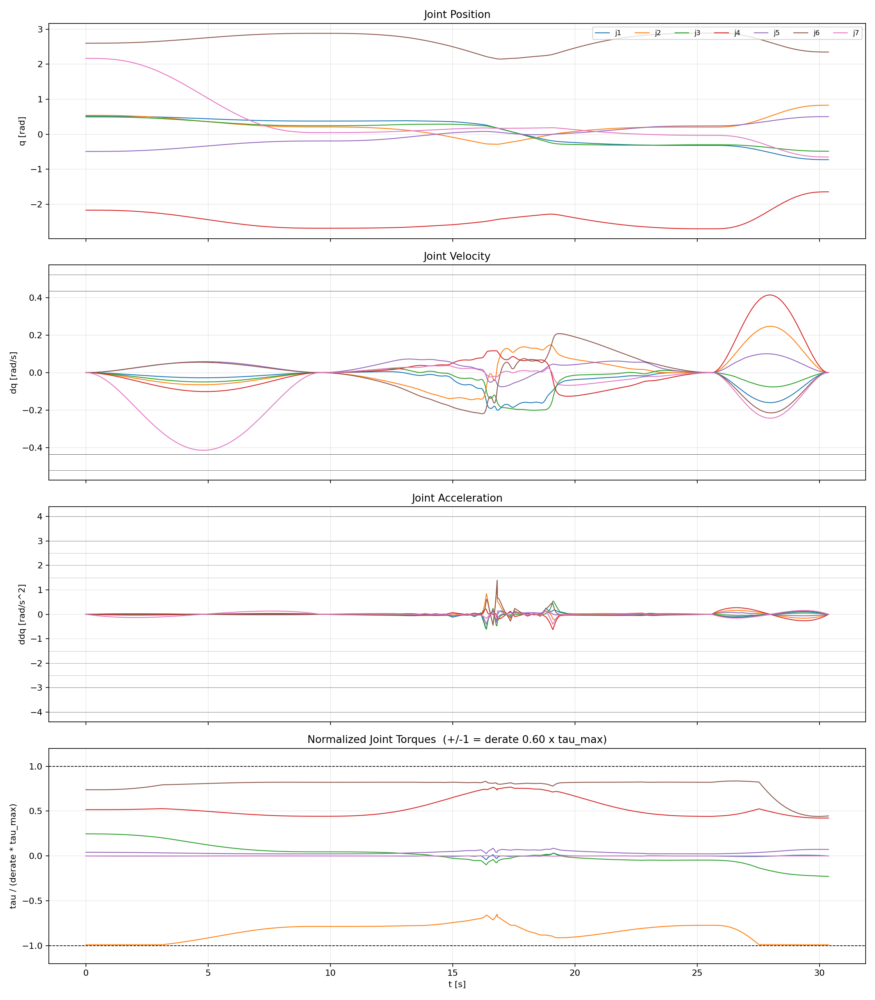

# Multi-Modal Path Planning on Constraint Manifolds for Robotic Manipulation

Master's thesis project on constraint-manifold motion planning for robotic manipulation under payload and torque limitations.

The planner combines supported sliding and free-space transport to generate **slide–lift–slide** trajectories. Environmental support is used as an additional manipulation mode, allowing the robot to move payloads through configurations that may not be feasible during unsupported carrying.

## 4.1 kg Payload Demonstration

[](hardware_results/4.1kg/overlay_video.mp4)

**Click the image above to open the 4.1 kg demonstration video.**

Additional experiment files:

- [4.1 kg overlay video](hardware_results/4.1kg/overlay_video.mp4)
- [4.1 kg animation](hardware_results/4.1kg/animation_video.mp4)
- [2.1 kg overlay video](hardware_results/2.1kg/overlay_video.mp4)
- [2.1 kg animation](hardware_results/2.1kg/animation_video.mp4)

## Overview

The project investigates multi-modal manipulation in which a robot can transition between:

- supported motion along a surface,
- free-flight transport,
- and transitions between these constraint manifolds.

Torque feasibility is evaluated throughout the planning process, and support contact can be exploited when unsupported configurations exceed the selected torque budget.

The repository contains the planner implementation, constraint handling, OMPL-based constrained planning, payload modelling, foliation-based free-carry refinement, experimental scripts, trajectory data, and hardware-result visualisations.

## Repository Structure

```text
.
+-- payload_planner/
¦   +-- run_panda.py
¦   +-- transport.py
¦   +-- ompl_planner.py
¦   +-- constraints.py
¦   +-- payload_model.py
¦   +-- robot_model.py
¦   +-- collision.py
¦   +-- transfer_foliation.py
¦   +-- experiments/
¦   +-- ...
¦
+-- hardware_results/
¦   +-- 2.1kg/
¦   +-- 4.1kg/
¦
+-- third_party/
¦   +-- franka_description/
¦
+-- docs/

Main Components
- run_panda.py — main planning entry point
- transport.py — multi-modal transport sequence generation
- ompl_planner.py — constrained motion planning with OMPL
- constraints.py — constraint-manifold and mode definitions
- payload_model.py — payload modelling and configuration
- robot_model.py — robot kinematics and dynamics interface
- collision.py — environment and collision geometry
- transfer_foliation.py — refinement of the free-carry manifold
- experiments/ — experimental scripts and processed thesis data
Hardware Results
Hardware experiments for 2.1 kg and 4.1 kg payloads are included in hardware_results/.
Each directory contains measured trajectory data, plots, animations and experiment videos.
Dependencies
The planner is implemented in Python and uses libraries including:
- NumPy
- Pinocchio
- OMPL
Some visualisation and analysis scripts require additional packages.
Thesis
Multi-Modal Path Planning on Constraint Manifolds for Robotic Manipulation
Master's thesis project on multi-modal constrained motion planning for robotic manipulation.
Third-Party Assets
Robot mesh assets originating from franka_description are included where required by the URDF models.
The corresponding upstream licence and notice are preserved under:
third_party/franka_description/

